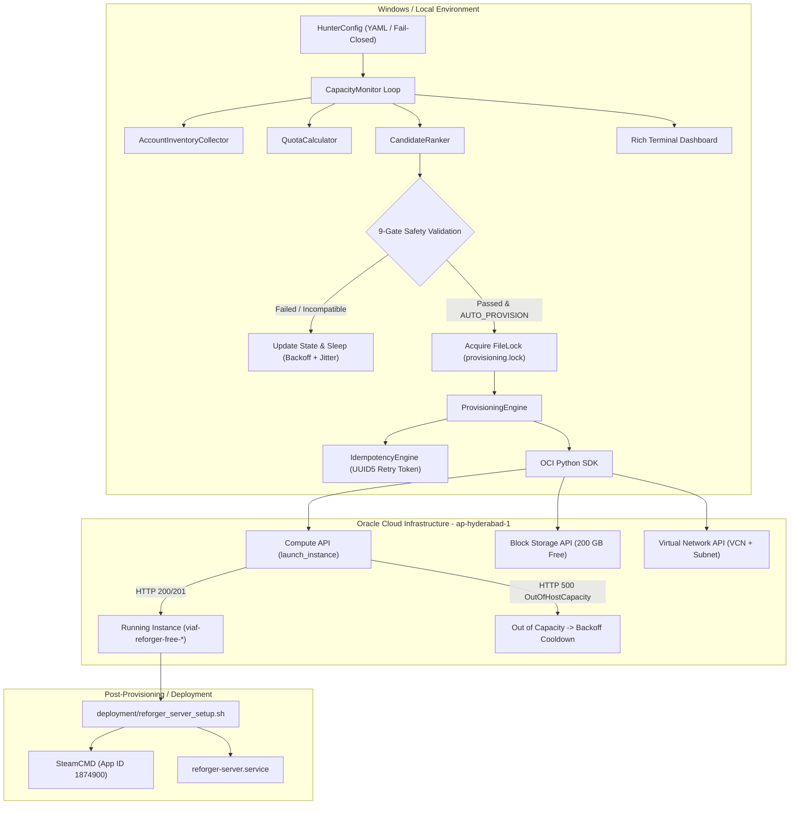

# System Architecture & Technical Specifications

**Oracle Free-Tier Hunter** is built with a fail-closed, defense-in-depth architecture designed to guarantee ₹0 cloud expenditure while maximizing compute performance and eliminating duplicate instances.

---

## 1. High-Level Architecture Diagram

---

## 2. The 9 Mandatory Pre-Launch Safety Gates

Before any instance launch request is submitted to OCI, every candidate must satisfy all 9 validation gates. If any single gate fails, automatic provisioning is blocked:

1. **Gate 1 — Shape Always Free:** The shape must exist in the authoritative Always Free catalogue (`VM.Standard.A1.Flex` or `VM.Standard.E2.1.Micro`).
2. **Gate 2 — Projected Zero Cost:** Projected recurring cost must be strictly ₹0.00. Any paid shape or billing upgrade triggers immediate rejection (`PAID_RESOURCE_BLOCKED`).
3. **Gate 3 — Workload Architecture Compatibility:** If native compatibility is required, the shape must have an official native Linux binary. (ARM64 is marked `INCOMPATIBLE_FOR_PRODUCTION` unless experimental emulation is explicitly enabled).
4. **Gate 4 — Storage Allowance:** The proposed boot volume must fit within the remaining Always Free block storage allowance (<= 200 GB total).
5. **Gate 5 — Duplicate Prevention:** The live inventory is queried to verify no instance with prefix `viaf-reforger-free-` is currently `RUNNING` or `PROVISIONING`.
6. **Gate 6 — Instance Safety Cap:** Total instances created by this tool must not exceed `maximum_instances_created_by_this_tool` (default 1).
7. **Gate 7 — Free Quota Availability:** Remaining Always Free OCPU and RAM headroom must equal or exceed the candidate's requirements.
8. **Gate 8 — Verified OS Platform Image:** Canonical Ubuntu Server LTS image must be discovered and verified for the shape's architecture.
9. **Gate 9 — Verified Public Subnet:** A valid public subnet with free ephemeral public IP assignment must be present.

---

## 3. Concurrency & Idempotency Protection

To guarantee that duplicate instances are never created even during power loss, network timeouts, or concurrent process runs:
- **Inter-process Mutex:** Protected by a local `FileLock` (`provisioning.lock`) with bounded acquisition timeouts.
- **OCI Retry Token:** Generates a deterministic `opc-retry-token` using UUID5 based on the tenancy OCID, candidate fingerprint, and an hourly epoch bucket. If a network interruption occurs, OCI recognizes the token and returns the existing instance rather than creating a second one.
- **Deterministic Collision-Resistant Naming:** Instances are named `viaf-reforger-free-<shape_short>-<ad_short>-<hash>`.
- **Post-Timeout Inspection:** If a launch call times out, the engine inspects the tenancy instance list to confirm whether the instance was provisioned before failing or retrying.
